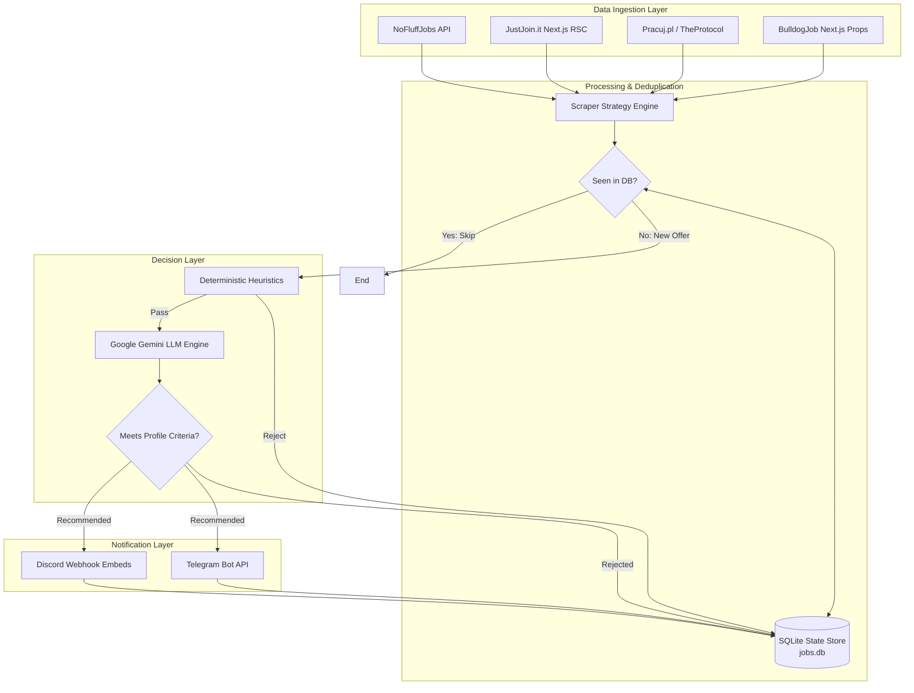

# 🤖 Job Hunter Agent

> **Automated IT Job Scraping, LLM Screening & Real-time Notification Engine**  
> *Engineered for high-precision career monitoring with multi-source ingestion, zero-cost serverless execution, and AI-powered vacancy evaluation.*

[](https://www.python.org/)
[](https://docs.pydantic.dev/)
[](https://ai.google.dev/)
[](https://github.com/features/actions)
[](LICENSE)

---

## 📌 Overview

**Job Hunter Agent** is an end-to-end Python pipeline that continuously monitors the Polish IT job market (*Just Join IT, Pracuj.pl / TheProtocol, No Fluff Jobs, BulldogJob*), aggregates junior and intern software developer positions, and filters them using an **LLM decision engine (Google Gemini)** to match a specific candidate profile.

Unlike naive scrapers or static RSS readers, this engine:
* Bypasses modern anti-bot protections (TLS fingerprinting, Cloudflare, Akamai) using pure network-level impersonation without memory-heavy headless browsers.
* Evaluates context and nuances in vacancy descriptions (detecting "fake juniors" demanding 3+ years of commercial experience).
* Delivers instant mobile push notifications via Discord Webhooks with rich interactive embeds and CV matching analysis.
* Operates 24/7 fully autonomously using GitHub Actions cron workflows with zero hosting costs.

---

## 🏗 System Architecture



---

## ⚡ Key Engineering Highlights

### 1. Advanced Anti-Bot & SSR Ingestion (`curl-cffi`)
Modern job platforms render content via Client-Side or React Server Components and employ bot detection (Akamai / Cloudflare). Instead of loading multi-gigabyte Chromium instances:
* Uses **TLS fingerprint impersonation** (`curl-cffi`) to mimic standard browser handshakes.
* Ingests data directly from Next.js hydration scripts (`self.__next_f` React Server Components and React Query `dehydratedState`), reducing execution time to **under 5 seconds** across all four portals with < 50 MB RAM consumption.

### 2. LLM Decision & Screening Engine (Gemini)
* Evaluates incoming job offers against structured candidate parameters (experience limits, tech stack overlap, location constraints, foreign languages, and formal student status requirements).
* Detects deceptive job descriptions (e.g. roles labeled "Junior" that specify 3+ years of enterprise experience in the body text).
* Enriches the notification with custom recommendations on which portfolio projects to emphasize when applying.

### 3. Stateful Deduplication & Regional Normalization
* Many recruitment agencies post identical vacancies across 16 different Polish voivodeships. The pipeline groups duplicate company/title combinations into unified records.
* An embedded SQLite engine tracks all processed vacancies, ensuring zero duplicate notifications and idempotent execution.

### 4. Zero-Cost Serverless Automation (GitHub Actions)
* Scheduled cron job running every 30 minutes during business hours (7:30 – 18:30 CET, Monday through Friday).
* Automatically commits state updates (`jobs.db`) back to the repository using atomic git transactions.
* Total monthly runtime: ~500 minutes out of GitHub's 2,000 free runner minutes.

---

## 🛠 Tech Stack

* **Core:** Python 3.10+, AsyncIO, Object-Oriented Programming (OOP)
* **Data Modeling:** Pydantic v2
* **Networking & Scraping:** `curl-cffi`, `httpx`, Next.js RSC & SSR State Extraction
* **Database:** SQLite3 (indexed unique constraints, state tracking)
* **Artificial Intelligence:** Google Gemini (`gemini-3.1-flash-lite`, `google-genai` SDK)
* **Notifications:** Discord Webhooks (Rich Embeds), Telegram Bot API
* **CI/CD & Cloud:** GitHub Actions, Linux Ubuntu Runners

---

## 🚀 Quickstart

### Prerequisites
* Python 3.10+
* Git

### Installation
```bash
# Clone repository
git clone https://github.com/kicpir99/job-hunter-bot.git
cd job-hunter-bot

# Install dependencies
pip install -r requirements.txt
```

### Configuration
Copy the template configuration file:
```bash
cp .env.example .env
```

Configure your environment variables in `.env`:
```env
# Discord Notification Webhook
DISCORD_WEBHOOK_URL=https://discord.com/api/webhooks/...

# Optional Telegram alternative
TELEGRAM_BOT_TOKEN=
TELEGRAM_CHAT_ID=

# Google Gemini API Key
GEMINI_API_KEY=your_gemini_api_key_here
GEMINI_MODEL=gemini-3.1-flash-lite
```

### Execution
```bash
# Run one full aggregation and screening cycle
python main.py

# Test Discord webhook integration
python main.py --test-discord

# Display database metrics and portal breakdown
python main.py --stats

# Reset tracking database
python main.py --reset-db
```

---

## 🧪 Testing

The test suite validates data models, scraper ingestion, deduplication, and screening heuristics:

```bash
pytest tests/
```

---

## 📄 License

This project is licensed under the MIT License - see the [LICENSE](LICENSE) file for details.
